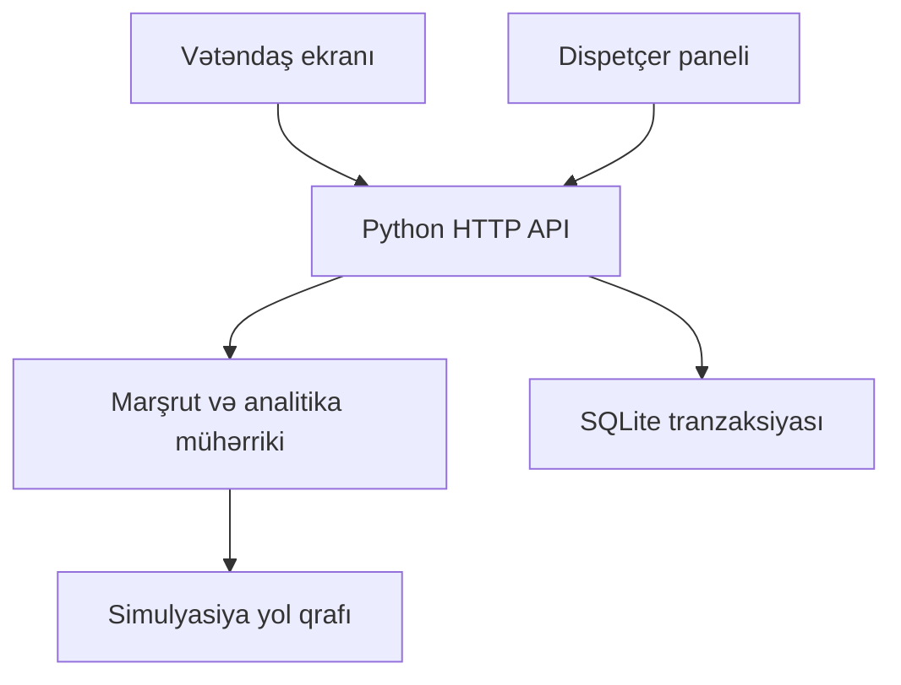

# Urban Crisis & Crowd Evacuation Engine

Azərbaycan dilində vətəndaş ekranı, operator paneli və SQLite ilə işləyən lokal prototip.
**Yalnız simulyasiya. Real SOS xidməti, real təhlükəsiz məntəqə kataloqu və ya real xəritə deyil.** Bakı rayon adları nümunədir; 4×4 yol şəbəkəsi coğrafi reallığı təmsil etmir.

## 1. İşə salınma — ən sadə yol
Python 3.10 və ya daha yeni versiya (3.12 ilə test edilib). Əlavə paket və pip install lazım deyil.
ZIP-i çıxarın, terminalı `urban-crisis` qovluğunda açın:

```sh
python server.py
```
Linux/macOS-da lazım gələrsə `python3 server.py` istifadə edin. Brauzerdə http://localhost:8000 açın. Dispetçer sekməsində terminalda yazılan `Operator token` dəyərini daxil edin. Token hər server startında yenidən yaradılır; `ADMIN_TOKEN` mühit dəyişəni ilə sabit dəyər təyin etmək olar. Real tokeni repozitoriyaya yazmayın.

Server standart olaraq yalnız 127.0.0.1 ünvanında dinləyir. DB ilk startda `data/crisis.db` faylında yaranır. Məlumatlar restartdan sonra qalır. Sıfırlamaq üçün serveri dayandırın və yalnız demo bazası olan `data/crisis.db` faylını silin.

## 2. Docker alternativi
```sh
docker compose up --build
# Başqa terminalda tokeni görmək üçün:
docker compose logs crisis
# Dayandırmaq üçün:
docker compose down
```
http://localhost:8000 ünvanını açın. Named volume məlumatı saxlayır. Docker konfiqurasiyası təqdim edilib, bu mühitdə Docker build icra edilməyib.

## 3. Demo — 4 dəqiqə
1. Vətəndaş ekranında Nəsimi seçin. Məntəqə, doluluq və yaşıl marşrutu göstərin.
2. Bir təhlükə düyməsini basın; eyni düyməyə yenidən basmaq aktiv SOS sayını artırmır. “Təhlükəsizəm” basın.
3. Dispetçerə tokenlə daxil olun. İkinci brauzer pəncərəsində vətəndaş ekranını saxlayın.
4. Tövsiyə edilən məntəqənin doluluğunu 90 edin: 2 saniyə ərzində alternativ məntəqə seçilir. 95 olduqda kritik doluluq alarmı yoxdur; 96 olduqda var.
5. Bu ssenarini təsdiqləməzdən əvvəl SOS demosunu etmək istəyirsinizsə doluluğu 25-ə qaytarın.
6. “5 SOS simulyasiya et”: beş ayrı demo kimliyindən eyni zonaya siqnal gəlir. Qırmızı həyəcan görünür.
7. “Qərarı təsdiqlə”: B1 göndərilir, s4 ehtiyat məntəqə açılır. Təkrar təsdiq əlavə resurs sərf etmir.
8. Yolu bağlayın: bağlı kənar marşrutdan çıxarılır. Şəbəkə əlaqəsizdirsə və ya bütün məntəqələr doludursa sistem “marşrut yoxdur” bildirir.

Demo bir ehtiyat məntəqə ilə başlayır. O açıldıqdan sonra növbəti birgə qərar üçün başqa ehtiyat məntəqə qalmır; sistem bunu açıq xəta kimi göstərir. Briqadanı geri qaytarmaq məntəqəni bağlamır.

## 4. Arxitektura

- `engine.py`: Haversine, Dijkstra, SOS klasterləri, qaydalar, operator qərarları.
- `server.py`: HTTP, giriş yoxlaması, parametr validasiyası, SQLite tranzaksiyaları.
- `static/`: əlavə build və CDN tələb etməyən HTML/CSS/JavaScript.
- `tests/`: domen və real HTTP sorğuları ilə inteqrasiya testləri.
- `docs/`: texniki izah, AI bəyannaməsi, test hesabatı, Challenge Drop cədvəli.

Dijkstra yalnız açıq yollardan keçir; seçimi uyğun məntəqələr arasında minimum yol məsafəsi edir. İstifadəçi ən yaxın qovşağa bağlanır; koordinat-qovşaq məsafəsi ümumi məsafəyə əlavə olunur. Bu bağlantının təhlükəsizliyi real dünyada qiymətləndirilmir. Demo əhatəsindən 2 km-dən uzaq nöqtə rədd edilir. Yol vəziyyəti `/api/state` simulyasiya endpointindən gəlir.

Bütün mutasiyalar bir SQLite tranzaksiyasında seriallaşdırılır. Qərar həm briqadanı, həm məntəqəni dəyişir və ya heç birini dəyişmir. Oxunuşlar analitikanı da hesablayır, beləliklə 5 dəqiqəlik pəncərədən çıxan siqnallar polling zamanı alarmı bağlayır. `BEGIN IMMEDIATE` itirilmiş yenilənmələrin qarşısını alır. Polling 2 saniyədir; WebSocket deyil.

## 5. Qayda semantikası
| Şərt | İcra |
|---|---|
| Doluluq ≥90% | Yeni tövsiyədən çıxarılır |
| Doluluq >95% | Qırmızı həyəcan |
| 300 saniyə ərzində ≥5 fərqli vətəndaş | Eyni zona VƏ YA SOS mərkəzindən ≤500 m radius |
| Eyni vətəndaşın təkrar aktiv SOS-u | Yeni siqnal yaratmır |
| Təhlükəsizəm | Həmin vətəndaşın SOS-u aktiv sayılmır |
| Təsdiq | Boş briqada + bağlı ehtiyat məntəqə tələb edir |

“Fərqli SOS” beş fərqli vətəndaş kimi şərh edilib; beş fərqli təhlükə növü deyil (tapşırıqda cəmi dörd növ var). Radius hər SOS nöqtəsi ətrafında Haversine məsafəsi ilə hesablanır. Zəncirvari qonşuluq avtomatik bir böyük klaster sayılmır. Eyni zonanın alarmı radius qrupunu tam əhatə edirsə təkrar alarm çıxarılmır; qismən üst-üstə düşən radius klasterləri ayrıca görünə bilər.

## 6. API
JSON body; operator əməliyyatlarına `Authorization: Bearer TOKEN` başlığı əlavə edin.

| Metod | Yol | Body / parametr |
|---|---|---|
| GET | `/api/health` | yox |
| GET | `/api/state` | Token varsa operator məlumatı; yoxdursa yalnız ictimai məlumat |
| GET | `/api/route?lat=40.403&lon=49.844` | koordinat |
| POST | `/api/sos` | `{"citizen":"example-123","kind":"yanğın","lat":40.403,"lon":49.844}` |
| POST | `/api/safe` | `{"citizen":"example-123"}` |
| POST | `/api/road` | `{"id":0,"blocked":true}` |
| POST | `/api/occupancy` | `{"id":"s1","occupied":96}` |
| POST | `/api/confirm` | `{"id":"alarm-id"}` |
| POST | `/api/release` | `{"id":"B1"}` |
| POST | `/api/rules` | `{"sos_count":5,"radius_m":500}` |

400 validasiya, 401 operator tokeni, 403 origin, 404 tapılmadı, 413 böyük body, 503 DB xətası. SOS növləri: `yanğın`, `dağıntı`, `su basması`, `tibbi yardım`. Nümunə token saxlanılmır. Operator tokeni yalnız brauzer yaddaşındadır, localStorage-a yazılmır. Vətəndaşın təsadüfi UUID-si localStorage-da saxlanılır.

## 7. Testlər
```sh
python -m unittest discover -s tests -v
```
24 test uğurla keçib: qayda sərhədləri, yol bağlanması, təkrar siqnal, zaman pəncərəsi, radius, təhlükəsiz status, resurs çatışmazlığı, giriş və paralel HTTP sorğuları.
Brauzer avtomatlaşdırması mühitin Chromium proses məhdudiyyətinə görə tamamlanmayıb. JS sintaksisi `node --check static/app.js` ilə keçib. UI-nin vizual və klik testləri komanda tərəfindən demo öncəsi aparılmalıdır.

## 8. Challenge Drop
Faktiki 12:00/13:00/14:00 şərtləri hələ təqdim edilməyib; uyğunluq iddiası yoxdur. Paneldən 90/95 hədləri, minimum SOS sayı, saniyə pəncərəsi və radius dəyişir və DB-də saxlanır. Yeni təhlükə növü üçün `KINDS` və frontend düymələri; yeni marşrut dəyəri üçün `route`; yeni data provayderi üçün yol qrafı adapteri dəyişməlidir. `docs/CHALLENGE_DROP.md` qeyd cədvəlini hər yeni şərtdə doldurun və regressiya testini əlavə edin.

## 9. Məhdudiyyətlər və gələcək iş
Lokal hackathon prototipidir. Real istifadədə identifikasiya, rate limiting, TLS, operator rolları, imzalanmış sensor məlumatı, monitorinq, məlumat saxlama müddəti və real yol/hazard provayderi lazımdır. UUID şəxsiyyət sübutu deyil; yeni brauzer kimliyi ilə spam mümkündür. Cari JSON-state SQLite modeli və O(n²) SOS analitikası böyük həcm üçün uyğun deyil. İstehsal versiyasında normallaşdırılmış PostgreSQL/PostGIS, geospatial indeks, queue və SSE/WebSocket planlanır. Qayda əsaslı qərardır; runtime AI/LLM çağırışı yoxdur. SOS qeydi doluluğu avtomatik artırmır; doluluq ayrıca operator/sensor axınıdır.
